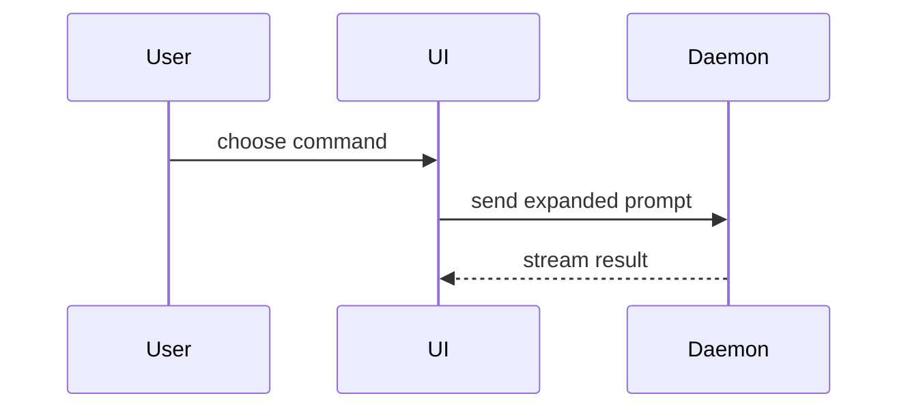

# PR Description

Write a short reviewer-facing GitHub PR description: why in one sentence, a visual of the change, proof it works, and how risky the merge is. The diff is the source of truth for details.

## When to Use

Use when the user asks to:

- write / prepare / draft a PR description
- describe changes on the current branch for reviewers
- update a GitHub pull request description

Do not use for code review findings, commit messages, or writing issues.

## Output Contract

Always produce GitHub-flavored markdown with exactly these four sections, in this order:

```markdown
## Motivation

<why, 1 sentence, 2 at most>

## What Was Done

- <area-level change>

<diagram, diff-sketch, or tree>

## Evidence

- **Before:** <screenshot/output/failing test run>
  **After:** <screenshot/output/passing test run>

## Merge Danger

**Door:** <one-way or two-way>

<optional: description>

**Blast Radius:** <one-word description>

<optional: potential ramifications of merge>
```

Skip all preambles and keep prose brief. Use the linked issue's domain language; without an issue, use the terms in the code. No "this PR…". English.

If a GitHub issue is linked, add a closing keyword line (`Closes #123`) at the very end, after Merge Danger. This is the only addition allowed to the four sections.

### Motivation

One sentence, two only if one is not enough. Simple words, business-oriented: who was affected and what was wrong or missing. No class, method, or file names. Do not invent business goals. Prefer the issue's outcome language; without an issue, derive it from commit subjects and the shape of the diff.

### What Was Done

Start with 1-2 area-level bullets, business-first. Keep only user-visible behavior changes, contract/flow changes, compatibility behavior, and business-rule changes. Optionally close with one sentence on what did not change (contracts, persisted shape, external behavior). Do not repeat Motivation, and do not narrate the diff: name behavior, contracts, and flows, not files, methods, or lines. Leave out tests, docs, lint/formatting, refactors, renames, file moves, and internal cleanup unless the user explicitly asks for them. If a bullet would not matter to a product owner, support engineer, or on-call reader, remove it.

Then add the one view that makes the key point clear, for a flow, contract, or behavior change. Place it right under the bullets it supports. Use a file tree only for a real structural refactor. Use one of these, rarely several:

Logic or algorithm as pseudocode:

```text
on(save)
  if content is unchanged
    return cached result
  write new content
  return fresh result
```

Runtime control flow as a call tree:

```text
submitForm
  createSession
    persistPrompt
    launchAgent
  navigateToSession
```

UI structure as a component tree, including state and module boundaries that matter:

```text
<SessionPage> (apps/example/src/routes/session.tsx)
  useSessionEvents()
  <SessionToolbar>
    <RunSkillButton> (packages/ui)
```

File responsibility or a broad refactor as a shallow file tree:

```text
src/
├── commands/       # parses user actions
├── sessions/       # owns session state
└── transport/      # sends API requests
```

Component interaction, control flow, or data flow with Mermaid (GitHub renders it):

````markdown

````


A diff when the point is what changes and the surrounding shape already exists. Match the diff shape to the topic (component tree, file layout, call tree, or control flow):

```diff
 on(save)
-  write content
+  if content is unchanged
+    return cached result
+  write new content
+  invalidate cache
```

The whole block when most of it is new, when omitted context would hide ownership or order, or when the reader needs a copyable target shape:

```ts
function expandSkill(command: string): string {
  const skillName = command.slice(1);
  return `use the ${skillName} skill`;
}
```

Keep only the calls, files, props, states, and boundaries the reviewer needs.

### Evidence

Required when behavior changes. Show a before and after of one test or output, as the exact test in pseudocode (not a list of test files). Screenshots are best when the change is visual and the environment allows it; execution output is next. For a pure refactor with no behavior change, write one line: `n/a – no behavior change`.

### Merge Danger

A one-way door cannot be walked back; a two-way door can. Destructive or hard-to-reverse changes are one-way. Blast radius is the scope of impact if something goes wrong: breakage for consumers, behavior shifts, and so on.

Door check, one line: treat as one-way a database migration, a public API or event/message schema change, or a message already published. If the change needs a sibling PR in another hub repo (e.g. `local-postgres` for schema or database setup, `wkrzywiec.github.io` for docs or posts that describe the change), name that repo in the blast radius.

## Example

````markdown
## Motivation

A reader who subscribed with an address that was already on the list got a generic error page instead of a message saying they were already subscribed.

## What Was Done

- The subscribe endpoint now answers `409` with a short message when the address is already on the list.

Other validation errors behave as before.

```diff
 subscribe(email)
+  if email already subscribed
+    return 409 "already subscribed"
   save email
   return 201
```

## Evidence

- **Before:** subscribing an existing address → 500
  **After:** same call → `409` with the "already subscribed" message

```text
given   address "a@example.com" is already subscribed
when    POST /subscribe with "a@example.com"
then    status == 409 and body mentions "already subscribed"
```

## Merge Danger

**Door:** two-way

**Blast Radius:** subscribe-endpoint

Closes #42
````

## Workflow

### 1. Resolve the git repo

This workspace is the hub. Project subdirectories are independent git repos. Never run git from the hub root.

```bash
git rev-parse --show-toplevel
```

- If the toplevel is a real project repo, use it as `repoPath`.
- If the toplevel is the hub (`mani.yaml` present), take a path from `$ARGUMENTS` or the user's message. If still unclear, ask which project directory — do not guess across repos.
- All later git and `gh` calls run inside that `repoPath`.

### 2. Gather change context

```bash
BASE=$(git symbolic-ref refs/remotes/origin/HEAD 2>/dev/null | sed 's@^refs/remotes/origin/@@' || \
  (git rev-parse --verify master 2>/dev/null && echo master || echo main))
BRANCH=$(git branch --show-current)

git log ${BASE}..HEAD --oneline
git diff ${BASE}...HEAD --stat
git diff ${BASE}...HEAD --name-only
```

Read the stat and file list, plus commit subjects. Skim the unified diff when the why, the before/after behavior, or the door type is still unclear. Test files in the diff are the source for Evidence.

If there are no commits vs `$BASE`, say so and stop.

### 3. Fetch why (GitHub issue, optional, then commits)

This step is optional and only runs when `gh` is installed and authenticated (`gh auth status`) and the repo has a GitHub remote. Otherwise skip to the commit-based fallback without complaining.

Resolve an issue number from, in order:

1. `$ARGUMENTS` if it matches `#?\d+`
2. Current branch name (e.g. `42-fix-rate-limit`, `feature/42-...`, `issue-42`)
3. Closing keywords or `#\d+` references in commit messages on `${BASE}..HEAD`

If found, fetch it and paraphrase the goal / user-visible outcome:

```bash
gh issue view <number> --json title,body,labels,state
```

Do not paste acceptance criteria, checklists, or implementation notes. If the call fails (not found, no access), fall back silently to commits.

If no issue, derive Motivation from commit subjects and the shape of the diff.

### 4. Find an open pull request

```bash
gh pr list --head "$BRANCH" --state open --json number,url,title --limit 1
```

Use the first open PR for this branch, if any. If `gh` is unavailable, treat it as "no open PR".

### 5. Write the description

Draft against the Output Contract. Check before showing it:

- Motivation is one sentence (two at most) with no code terms
- What Was Done is 1-2 business-first bullets (no implementation chores) plus one visual for behavior/flow/contract, with no file-by-file narration and no tests/docs/chores
- Evidence is a real before/after (or `n/a – no behavior change`); do not claim results you did not see in the diff, commit, or a test run, and mark inferred "before" behavior as inferred when showing the draft
- Merge Danger names the door and a one-word blast radius, and applies the door check
- `Closes #N` appears only when an issue was actually resolved in step 3
- Markdown is valid GitHub markdown

### 6. Deliver

If an open PR exists — update it, then show the markdown:

```bash
gh pr edit <number> --body-file <file>
```

Write the body to a temp file first (scratchpad if available) so quoting and newlines survive. Tell the user the PR was updated (number + URL). Do not change title, labels, assignees, or reviewers.

If no open PR — do not create one. Show the markdown in a single ```` ```markdown ```` fence so it is one copy-paste into the GitHub description field.

Never wrap the PR description payload itself in an extra fence.

## Guardrails

- Do not commit, push, create a PR, or change PR title/labels/reviewers
- Do not review the code or suggest follow-ups unless the user asks
- Do not mention this skill in the description
- If the working tree is dirty, still describe committed `${BASE}..HEAD` changes; mention uncommitted files only if they would make the description misleading
